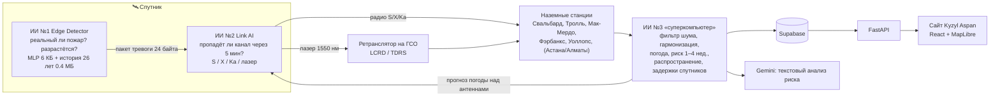

# 🔥🛰️ HELIOS-SHIELD

**Гармонизация 26 лет пожаров NASA (MODIS + VIIRS), три ИИ (2 на борту + 1 на Земле) и умная доставка тревог.**
Регион по умолчанию — Казахстан (меняется в `config/settings.yaml`). Здесь весь бэкенд — данные, фильтры,
обученные модели, база Supabase и API. Сайт — приложение **Kyzyl Aspan** (папка `kyzyl-aspan/`, отдельный
репозиторий): оно берёт реальные данные и результаты всех трёх ИИ через `/v1` этого API.

---

## Что уже работает

| Блок | Статус | Главный результат |
|---|---|---|
| Данные NASA FIRMS 2000–2025 | ✅ | 3 744 999 обнаружений MODIS + VIIRS по Казахстану (без ключа) |
| Фильтрация шума (улучшенная версия трёх проектов) | ✅ | 1 406 постоянных источников (факелы/заводы), 555 тыс. промышленных точек отсеяно |
| H3 + гармонизация MODIS↔VIIRS | ✅ | ступенька 2012 г.: сырые точки ×3.26 → наш ряд ×1.09 к эталону Aqua; тест «MODIS выключили»: ошибка −7.4%, ρ = 0.992 |
| ИИ №1 (борт) — критичность пожара | ✅ | ROC-AUC 0.994 «настоящий пожар?», 0.846 «разрастётся?»; модель 6 КБ |
| ИИ №2 (борт) — прогноз потери связи | ✅ | предупреждает заранее о 95% обрывов (правило по запасу — 40%) |
| ИИ №3 (Земля) — риск на 1–4 недели | ✅ | ROC-AUC 0.931 vs 0.890 у климатологии (тест 2024–2025) |
| Fire DNA, сдвиг сезона, слепые зоны, Time Machine | ✅ | пик сезона сместился на −23 дн./10 лет (значимо и по Aqua-only) |
| Связь: орбиты, физика радио/лазер, планировщик, доставка | ✅ | задержка тревоги 139 мин (сейчас) → 29 мин (ИИ на борту) → ~1 с (станция/ретранслятор) |
| Supabase | ✅ | 22 таблицы, ~527 тыс. строк, чтение для фронтенда открыто |
| API (FastAPI) | ✅ | 25 эндпоинтов `/api/*` + 18 эндпоинтов `/v1/*` для сайта, Swagger на `/docs` |
| Сайт Kyzyl Aspan | ✅ | реальные данные вместо демо, 6 слоёв ИИ на карте, Time Machine, карточка района, страница миссии, 8 языков |
| Kaggle-ноутбук обучения | ✅ | `notebooks/helios_kaggle_training.ipynb` (собирается из исходников) |

---

## Архитектура (по совету ментора: «два ИИ на борту, третий — на Земле»)



---

## Быстрый старт

```bash
python -m venv .venv --system-site-packages
```

```bash
.venv\Scripts\python -m pip install -r requirements.txt
```

```bash
.venv\Scripts\python -m helios.cli check-apis
```

```bash
.venv\Scripts\python -m helios.cli all
```

Отдельные шаги: `fetch-history`, `build-history`, `fetch-weather`, `train-edge`, `train-link`, `train-ground`,
`analytics`, `update-current`, `forecast`, `simulate-delivery`, `nrt`, `refresh`, `sync-supabase` (подробно в `helios/cli.py`).
Полный прогон с нуля занимает ~25 мин на обычном ноутбуке.

### Весь мир (все страны и регионы)

Архив FIRMS «все страны» качается кусками в 16 потоков с докачкой (сервер отдаёт ~80 КБ/с на соединение; ~7 ГБ
за 1–1,5 ч), каждый год сразу превращается в Parquet, а тяжёлые группировки считает DuckDB вне памяти:

```bash
.venv\Scripts\python -m helios.world.fetch
```

```bash
.venv\Scripts\python -m helios.world.ingest
```

```bash
.venv\Scripts\python -m helios.world.aggregate
```

```bash
.venv\Scripts\python -m helios.world.edge
```

```bash
.venv\Scripts\python -m helios.world.forecast
```

```bash
.venv\Scripts\python -m helios.onboard.export_c
```

По шагам: загрузка → Parquet → реестр постоянных источников мира, «горящие гексагоно-сутки» H3 res 2–7, ряды по
странам и регионам (~25 мин) → ИИ №1 v2 на мировых данных → ИИ №3 для всего мира (≈1 ч на CPU) → бортовой код на C
(самопроверка и кросс-компиляция через `pip install ziglang`). Прогноз «сейчас» обновляется раз в сутки в `refresh`.

### Сайт с реальными данными

Сначала API (из этой папки), потом сайт (из `kyzyl-aspan/`, нужен Node.js и pnpm):

```bash
.venv\Scripts\python -m uvicorn api.server:app --host 127.0.0.1 --port 8000
```

```bash
cd kyzyl-aspan && pnpm install && pnpm dev
```

Сайт сам проверяет `/v1/helios/status`: если API отвечает — все цифры реальные (значок «Реальные данные NASA FIRMS»),
если нет — показывает синтетическое демо. ИИ-анализ Gemini идёт через сервер приложения: `pnpm server` (ключ
`GEMINI_API_KEY` в `kyzyl-aspan/.env`; без ключа — сводка по правилам, уже с прогнозом ИИ №3).

### Автообновление (каждый час)

В Планировщике заданий Windows зарегистрирована задача **«HELIOS-SHIELD NRT refresh»**: каждый час в :07 она запускает
`.venv\Scripts\pythonw.exe -m helios.cli refresh` (без окна консоли).

| Как часто | Что делает |
|---|---|
| каждый час | свежие пожары FIRMS NRT (48 ч) → фильтр шума → ИИ №1 → тревоги → прогноз распространения по ветру → задержки спутников (CMR) → космическая погода → Supabase |
| раз в 3 часа | план связи на 24 ч (окна без связи) и слепые зоны по облачности |
| раз в сутки | погода NASA POWER текущего года, пожары года (с `FIRMS_MAP_KEY`), прогноз риска ИИ №3 |

* Работает, пока компьютер включён и вы вошли в Windows; пропущенный запуск выполнится после пробуждения.
* Один запуск — 30–90 с. Два запуска одновременно не стартуют, зависший прерывается через 45 мин.
* Лог: `data\logs\refresh.log`, итог последнего запуска: `artifacts\reports\refresh_last.json` (и в Supabase `reports`, ключ `refresh_last`).
* `fire_detections_nrt.ingested_at` — момент, когда мы впервые увидели точку. Со временем из него набирается реальная
  статистика задержки FIRMS (от съёмки до появления в ленте) с точностью до часа.
* В Supabase ежедневно в 03:20 UTC работает очистка (pg_cron, `private.helios_retention`): прогнозы распространения
  хранятся 7 дней, план связи 3 дня, окна без связи 14 дней, NRT-точки и тревоги 180 дней. История не удаляется.

Управление (PowerShell):

```bash
Start-ScheduledTask -TaskName 'HELIOS-SHIELD NRT refresh'
```

```bash
Unregister-ScheduledTask -TaskName 'HELIOS-SHIELD NRT refresh' -Confirm:$false
```

```bash
powershell -NoProfile -ExecutionPolicy Bypass -File scripts\register_refresh_task.ps1
```

API для будущего сайта:

```bash
.venv\Scripts\python -m uvicorn api.server:app --port 8000
```

Тесты:

```bash
.venv\Scripts\python -m pytest -q tests
```

---

## Ключи API (`.env`)

Без ключей уже работают: годовой архив и NRT-ленты FIRMS, NASA POWER, CMR, EONET, GIBS, CelesTrak, NOAA SWPC, GFZ, Open-Meteo.

| Ключ | Зачем | Где взять |
|---|---|---|
| `FIRMS_MAP_KEY` | история 2026 г. и любые даты через Area API (без него — только последние 7 дней) | https://firms.modaps.eosdis.nasa.gov/api/map_key/ |
| `GEMINI_API_KEY` | текстовый анализ риска по клику (без ключа — офлайн-аналитик по шаблону) | https://aistudio.google.com/apikey |
| `EARTHDATA_TOKEN` | скачивание самих гранул (сейчас не обязательно) | https://urs.earthdata.nasa.gov/ |
| `NASA_API_KEY` | DONKI и др. (по умолчанию `DEMO_KEY`) | https://api.nasa.gov/ |
| `SUPABASE_*`, `HELIOS_INGEST_TOKEN` | уже заполнены для проекта `helios-shield-fire` | — |

---

## Результаты (честно, на данных, которые модели не видели)

### 1. Фильтрация шума — что взяли и что улучшили

| Шаг | Источник | Улучшение HELIOS |
|---|---|---|
| P(fire) из MODIS 0–100% и VIIRS l/n/h + контраст ΔT(4–11 мкм) | flare-chronos (MIT) | + штраф за блик, + поддержка соседями |
| Южно-Атлантическая аномалия, день/ночь по SZA < 85° | flare-chronos (MIT) | векторно, быстро |
| Low confidence (MODIS < 30, VIIRS «l») | FIRMS / Kiln-Watch | не выкидываем вслепую: подтверждённые соседями точки остаются |
| Постоянные источники | flare-chronos + MODIS-VIIRS-fires (HDBSCAN) + Kiln-Watch (`type`) | единый реестр с 4 уликами и баллом 0..1, буфер для пикселя MODIS 1 км |
| Солнечный блик | — | **новое**: угол блика по геометрии Солнца и сенсора |
| Одиночные артефакты | — | **новое**: KD-дерево 3 км × ±2 сут |
| Подтверждение другим спутником | идея эпизодов flare-chronos | **новое**: другой спутник в 2 км и ±60 мин |

Итог по 3.74 млн точек: оставлено 88.7% MODIS и 81.5% VIIRS; 555 тыс. — промышленные источники
(в Казахстане много факелов: Тенгиз/Карачаганак-подобные кластеры на западе, ТЭЦ Экибастуза/Павлодара).

### 2. Гармонизация (H3 «сгоревшие гексагоны» + калибровка к шкале Aqua MODIS)

| Проверка | Сырые точки | Union cell-days | **HELIOS** | Эталон Aqua-only |
|---|---|---|---|---|
| Ступенька при запуске Suomi-NPP (2012) | ×3.26 | ×1.91 | **×0.73** | ×0.66 |
| Ступенька при запуске NOAA-20 (2018) | ×1.58 | ×1.24 | **×0.92** | ×0.91 |

Тест «MODIS выключили» (калибровка 2012–2016, восстановление 2017–2020 только по VIIRS): суммарная ошибка
**−7.4%**, медианная месячная **7.6%**, корреляция **ρ = 0.992**, 95% интервалы накрывают **95.6%** месяцев.
Отдельно видно, что орбита Aqua «уплывает» после 2022 г.: VIIRS-мосты держат ряд стабильным.

### 3. ИИ №1 — бортовой детектор (тест 2025 г., 142 803 обнаружения)

| Вопрос | ИИ №1 | Простое правило |
|---|---|---|
| «Это природный пожар, а не факел/блик?» ROC-AUC | **0.994** | 0.457 (уверенность FIRMS) |
| «Разрастётся за 72 ч?» ROC-AUC / PR-AUC | **0.846 / 0.554** | 0.642 / 0.268 (по FRP) |
| Точность метки КРИТИЧНО | **75.6%** | — |

1 482 параметра, ONNX int8 ≈ 6 КБ, ~0.2 мкс на точку на CPU, бортовая таблица 26-летней истории 443 КБ.
Веса также в JSON (`artifacts/models/edge_detector_weights.json`) — можно запустить в браузере или на микроконтроллере.

### 4. ИИ №2 — бортовой прогноз потери связи (тест на непросмотренных пролётах)

| | ИИ №2 | Правило «мало запаса — скоро обрыв» |
|---|---|---|
| ROC-AUC | **0.990** | 0.776 |
| Предупреждение заранее при 5% ложных тревог | **95%** обрывов | 40% |
| PR-AUC по каналам: Ka / S / лазер | **0.42 / 0.45 / 0.32** | 0.006 / 0.14 / 0.08 |

Данные: реальные орбиты (TLE), реальная погода у 12 станций (ERA5), реальная космическая погода (включая
суперсторм мая 2024, Kp = 9) + физическая модель линий. Телеметрии спутников в открытом доступе нет,
поэтому метки — физическая симуляция (честно указано в коде).

### 5. ИИ №3 — прогноз риска (ячейки H3 res-5, тест 2024–2025)

| Горизонт | ROC-AUC ИИ | ROC-AUC климатология | PR-AUC ИИ | PR-AUC климатология | Ловим в топ-10% ячеек |
|---|---|---|---|---|---|
| 1 неделя | **0.931** | 0.890 | **0.365** | 0.262 | **77%** (клим. 68%) |
| 4 недели | **0.909** | 0.888 | **0.298** | 0.262 | **70%** (клим. 67%) |

**Time Machine**: например, «как будто сегодня 3 июня 2024»: PR-AUC ИИ 0.221 против 0.097 у сезонного алгоритма;
ИИ лучше сезонного алгоритма во всех 6 сценариях 2024–2025 на горизонте 1 неделя.

### 6. Аналитика
* **Сдвиг пожарного сезона** (2003–2025): начало −10 дн./10 лет (p = 0.006), пик −23 дн./10 лет (p = 0.0003);
  значимо и по ряду «только Aqua MODIS» → **это не артефакт смены спутников**. Конец сезона не сдвинулся.
* **Fire DNA** (ячейки res-7): промышленные / сельхозпалы / природные / единичные — с вероятностью и уверенностью.
* **Слепые зоны**: проверка показала, что облака «прячут» очаги в ячейках высокого риска (p ≥ 0.5: после облачной
  пустой недели пожары находят на 14% чаще, чем после ясной), а в малорисковых облака приходят с дождём.

### 7. Умная доставка тревог (реальный пожарный день 20.03.2025, 1 177 тревог)

| Схема | Медиана задержки |
|---|---|
| A. Как сейчас (NRT FIRMS, реальная задержка гранул по NASA CMR) | **139 мин** |
| B. ИИ №1 на борту + ближайшая станция сети NASA/ESA (пакет 24 байта) | **29 мин** |
| C. + станции прямого приёма в Казахстане (условные) | **~1 с** |
| D. + ретранслятор на ГСО (TDRS-13 / LCRD) | **~1 с** |

Сеть спутников: 74% КРИТИЧНЫХ тревог подтвердил другой спутник в течение 12 ч (медиана — через 31 мин).
Планировщик связи заранее знает окна без связи: только наземные станции — ~13–14 ч/сутки без связи (макс. разрыв ~40 мин),
с реальными ретрансляторами — ~1.5–2 ч/сутки.

---

## Физика «радио vs лазер» — что сказал ментор и что мы уточнили

Формулы ментора верны по форме, мы проверили числа (`helios/comms/physics.py`, эндпоинт `/api/link/simulate`):

| Утверждение | Проверка |
|---|---|
| f_p ≈ 9·√N_e, поглощение ∝ N_e·ν/f² | ✅ днём f_p ≈ 9 МГц |
| «Вспышка на Солнце глушит X-диапазон» | ⚠️ нет: при вспышке X1 КВ (10 МГц) теряет >10 дБ, а X-диапазон ~10⁻⁵ дБ. Реальные угрозы S/X/Ka — дождь (особенно Ka), ионосферные мерцания у полярных станций при бурях (Kp), шум Солнца рядом с лучом |
| Расходимость 1.22·λ/D = 8.6 мкрад (λ = 1064 нм, D = 15 см) | ✅ |
| 100 Вт с 800 км на приёмник r = 0.5 м | ✅ пятно ~3.6 м, ~3.8 Вт оптики → ~2 Вт электричества (GaAs 55%) |
| «Лазеру ничего не мешает» | ⚠️ ионосфера — да, не мешает; но облака закрывают линию на 60–120 дБ → нужны разнесённые станции и ретранслятор |
| Дождь и лазер | ⚠️ ливень тоже гасит лазер (ITU-R P.1814: γ = 1.076·R^0.67 дБ/км): при 5 мм/ч ещё +33 дБ запаса, при 20 мм/ч — на грани (+4 дБ), при 50 мм/ч — −37 дБ, и калькулятор переключает данные на X-диапазон. Учтено и в симуляции, на которой учится ИИ №2 |
| 100 Вт для связи | ⚠️ для данных хватает ~2 Вт: детектору нужно ~100 фотонов на бит (≈ −50 дБм на 1 Гбит/с) |

Калькулятор миссии (`/api/mission-design`): высоты орбит тепловизоров от МКС (410 км) до ГСО (35 786 км), период,
ширина полосы и минимальный объектив по дифракции (например, для 30 м на 11 мкм с 829 км — 37 см).

---

## Supabase (`helios-shield-fire`, eu-central-1)

Фронтенд читает таблицы напрямую ключом `SUPABASE_PUBLISHABLE_KEY` (RLS: всем только чтение):
`burning_calendar`, `calibration`, `static_sources`, `fire_dna`, `cell_activity_monthly`, `season_shift_cells`,
`risk_forecast`, `time_machine`, `blind_spots`, `spread_forecasts`, `fire_detections_nrt`, `alerts`, `comm_passes`,
`comm_blackouts`, `satellite_delays`, `space_weather`, `model_registry`, `ai_analyses`, `reports`,
`satellites`, `ground_stations`, `regions` + представления `v_latest_alerts`, `v_calendar_matrix`, `v_risk_latest`,
`v_comm_blackouts_latest`. Примеры запросов для фронтенда — [docs/FRONTEND_INTEGRATION.md](docs/FRONTEND_INTEGRATION.md).

Запись — только сервер: функция `helios_ingest(token, table, rows)` проверяет sha256-хэш `HELIOS_INGEST_TOKEN`.
Советник Supabase предупреждает, что эту SECURITY DEFINER функцию может вызвать `anon` — это намеренно (без
256-битного токена она ничего не пишет). Чтобы убрать предупреждение: добавьте в `.env`
`SUPABASE_SERVICE_ROLE_KEY` (Dashboard → Project Settings → API Keys) и выполните
`revoke execute on function public.helios_ingest(text, text, jsonb, text) from anon, authenticated;`.

---

## API

Для сайта Kyzyl Aspan (`api/world.py` + `api/kyzyl.py`, префикс `/v1`; Vite и сервер приложения проксируют его, CORS не нужен):
мир — `/v1/hex` (гексагоны res 2–7 по всем точкам), `/v1/regions/geo`, `/v1/regions/stats`, `/v1/area/stats`;
`/v1/detections`, `/v1/fires`, `/v1/calendar`, `/v1/regions`, `/v1/overview`, `/v1/onboard-model` (контракт приложения)
и `/v1/helios/status`, `scenarios`, `risk`, `alerts`, `static`, `blind`, `spread`, `satellites`, `area`, `context`,
`mission`, `link`. Данные для них готовит `python -m helios.cli export-frontend` (входит в `all`).

Общие эндпоинты: `GET /api/health`, `/api/config` (слои GIBS, ключ Supabase для фронтенда), `/api/fires/recent`, `/api/alerts`,
`/api/static-sources`, `/api/calendar`, `/api/harmonization`, `/api/fire-dna`, `/api/season-shift`, `/api/risk`,
`/api/timemachine?as_of=2024-06-03`, `/api/blind-spots`, `/api/spread`, `POST /api/analyze` (Gemini),
`POST /api/edge/score` (ИИ №1 на любых точках), `/api/edge/packet/{hex}`, `/api/link/simulate`, `/api/mission-design`,
`/api/comm/plan`, `/api/satellites/positions`, `/api/satellites/delays`, `/api/space-weather`, `/api/eonet`,
`/api/models`, `/api/reports/{key}`.

---

## Kaggle

`notebooks/helios_kaggle_training.ipynb` — самодостаточный: ставит зависимости, записывает пакет (`%%writefile`,
код виден жюри), качает данные NASA и обучает все три ИИ по разделам *Historical Intelligence → Edge AI Simulation →
Smart Alert Delivery*. На Kaggle: **Settings → Internet: On**; ключи — в **Add-ons → Secrets** (не обязательно).
Пересобрать после правок кода: `python scripts/build_kaggle_notebook.py`.

---

## Структура

```
config/settings.yaml          регион, пороги фильтров, H3, периоды обучения
helios/apis/                  FIRMS, POWER, CMR, EONET, GIBS, DONKI, CelesTrak, SWPC, GFZ, Open-Meteo, Gemini, контур страны
helios/processing/            солнце/блик, геометрия пикселя, фильтры, реестр факелов, гармонизация, Fire DNA,
                              сдвиг сезона, слепые зоны, распространение по ветру
helios/models/                ИИ №1 edge_detector, ИИ №2 link_ai, ИИ №3 ground_forecast, time_machine, признаки
helios/comms/                 орбиты SGP4, станции, физика радио/лазер, пакеты 24 Б, симулятор каналов, планировщик, доставка
helios/db/supabase_sync.py    выгрузка в Supabase
helios/pipeline.py, cli.py    оркестрация
helios/frontend_export.py     выгрузка для сайта: выборка точек, гексагоно-дни res 5, калибровка, бортовая модель
api/server.py                 FastAPI (общие /api/*)
api/kyzyl.py                  /v1/* для сайта Kyzyl Aspan (контур Казахстана)
api/world.py                  /v1/* для всего мира: гексагоны по зуму, пиксели, регионы, календарь, прогноз
helios/world/                 мировой контур: загрузка архива (fetch), Parquet (ingest), регионы admin-1 (regions),
                              агрегаты DuckDB (aggregate), NRT 7 дней (nrt), ИИ №3 мира (forecast), ИИ №1 v2 (edge)
helios/onboard/               бортовой ИИ на C99 для любого спутника: квантование int8 и генерация кода (export_c)
artifacts/onboard_c/          готовый C-код, самопроверка, отчёт о сборке под 7 бортовых процессоров
kyzyl-aspan/                  сайт (отдельный git-репозиторий, React + MapLibre)
supabase/migrations/          схема БД
notebooks/                    Kaggle-ноутбук; scripts/ — его сборщик
artifacts/models, reports     обученные модели (ONNX/JSON/joblib) и метрики
```

## Ограничения (говорим жюри честно)
* ИИ №2 обучен на физической симуляции каналов (реальные орбиты/погода/космическая погода; открытой телеметрии нет).
* Станции в Казахстане и ретранслятор на 76° в.д. — условные сценарии «что если».
* Suomi-NPP перестал давать NRT-данные 2 ноября 2026 г.; в работе NOAA-20/21, Terra, Aqua.
* Без `FIRMS_MAP_KEY` история текущего года — только последние 7 дней (текущий прогноз риска считается с этим пробелом).
* NASA DONKI сейчас не отвечает (api.nasa.gov → 404, зеркало CCMC → таймаут); вспышки берём из NOAA SWPC (GOES),
  а `check-apis` показывает отказ DONKI честно, а не «0 вспышек».
* Fire DNA — вероятностная классификация по признакам; истинную причину пожара без полевых данных установить нельзя.

Источники кода и данных — в [THIRD_PARTY_NOTICES.md](THIRD_PARTY_NOTICES.md).
